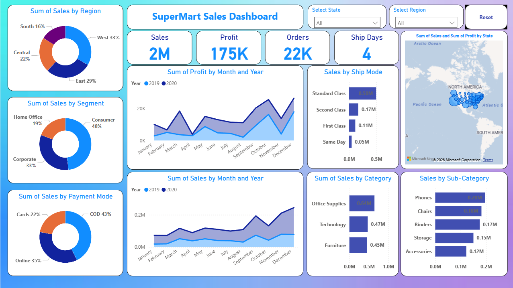

# SuperMart Sales & Performance Dashboard (Power BI)

An interactive and comprehensive Power BI dashboard designed to analyze retail sales performance, profitability, customer demographics, and order delivery dynamics across North America.

---

## 🖼️ Dashboard Preview



---

## 📌 Key Metrics (KPIs)

* **Total Sales:** $2M
* **Total Profit:** $175K
* **Total Orders:** 22K
* **Average Ship Days:** 4 Days

---

## 🔍 Key Insights & Analysis

### 1. Regional & Geographic Sales
* **Top Performing Region:** **West** accounts for the largest share (**33%**) of overall sales, followed by **East (29%)**, **Central (22%)**, and **South (16%)**.
* **Spatial Analysis:** Interactive map chart showcasing total sales and profit distribution across North American states.

### 2. Customer Segmentation & Payment Preferences
* **Customer Segments:** **Consumer** is the primary driver generating **48%** of total sales, followed by **Corporate (33%)** and **Home Office (19%)**.
* **Payment Methods:** **Cash on Delivery (COD)** leads as the preferred payment method at **43%**, followed by **Online (35%)** and **Cards (22%)**.

### 3. Product & Shipping Performance
* **Top Categories by Sales:** **Office Supplies ($0.64M)**, **Technology ($0.47M)**, and **Furniture ($0.45M)**.
* **Sub-Category Breakdown:** High sales volume in **Phones ($0.20M)** and **Chairs ($0.18M)**.
* **Shipping Modes:** **Standard Class** dominates order volume at **0.50M units**, while **Same Day** delivery accounts for **0.05M**.

### 4. YoY Growth Trends (2019 vs 2020)
* High seasonal spikes in sales and profits during Q4 (**October to December**), showing strong year-over-year growth trajectory in 2020 compared to 2019.

---

## 🛠️ Tools & Technologies Used

* **Power BI Desktop:** Data Modeling, DAX Measures, Visualization Layout & Slicers
* **Power Query:** Data Extraction, Cleaning, and Transformation
* **Data Source:** Sample Superstore / SuperMart Retail Dataset

---

## 🚀 How to Use / View This Project

1. **Clone the Repository:**
   ```bash
   git clone [https://github.com/your-username/SuperMart-Sales-Dashboard.git](https://github.com/your-username/SuperMart-Sales-Dashboard.git)
